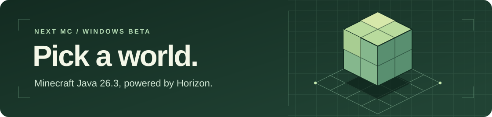
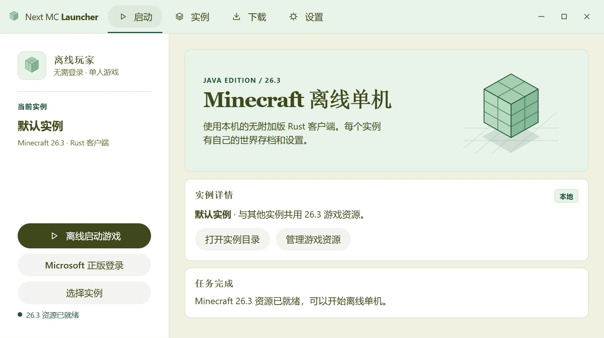
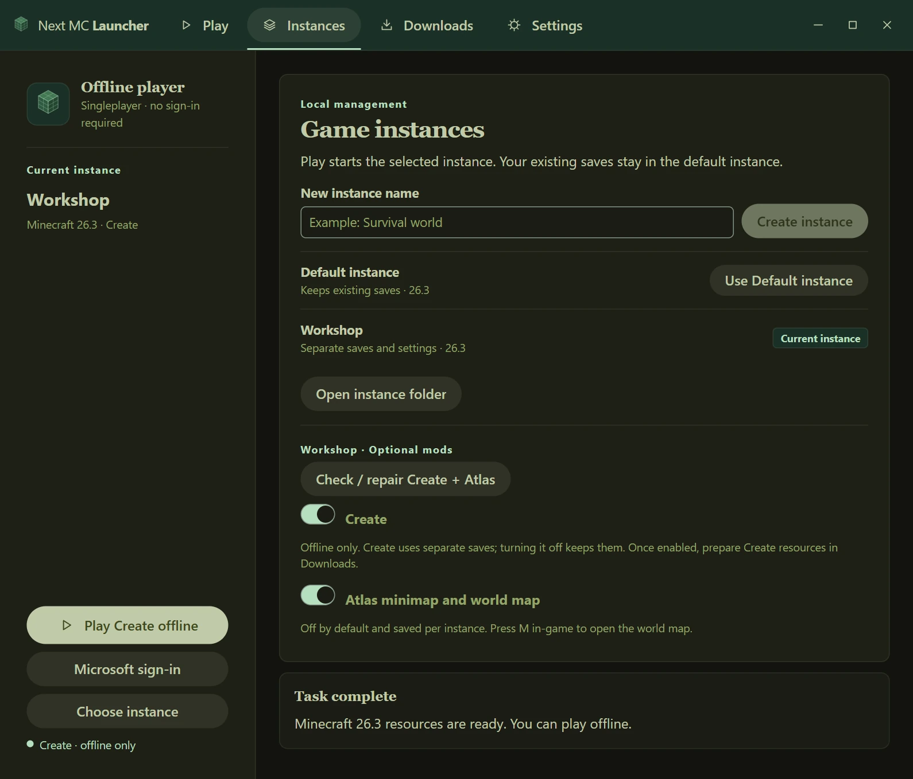

# Next MC Launcher

  <strong>给生存存档和机械工坊，各留一个实例。</strong> 
  Keep your survival world and your workshop in separate instances.

  <strong>Windows x64</strong> · Minecraft Java 26.3 · Rust / Horizon · v0.1.0-beta.2 
  <a href="https://github.com/A5yncX/next-mc-launcher/releases/download/v0.1.0-beta.2/NextMC-Setup-Windows-x64.exe"><strong>下载安装版 / Download Setup</strong></a> ·
  <a href="https://github.com/A5yncX/next-mc-launcher/releases/download/v0.1.0-beta.2/NextMC-Windows-x64.zip">便携 ZIP / Portable ZIP</a> ·
  <a href="https://github.com/A5yncX/next-mc-launcher/releases/tag/v0.1.0-beta.2">版本说明 / Release notes</a>

<a href="#简体中文">简体中文</a> · <a href="#english">English</a> · <a href="INSTALL.zh-CN.md">安装与排错</a>

## 简体中文

Next MC 是 [Horizon][horizon] 的非官方 Windows 启动器。用 Rust 客户端玩 Minecraft Java 26.3，准备好资源就能开单人世界，不用登录。

- **存档分开**：每个实例有自己的世界和设置。普通模式与机械动力也各自存档，关闭模组不会删档。
- **缺什么补什么**：先复用已有安装文件，只有手动点下载时才从 Mojang 补齐缺失文件，并显示校验和下载进度。
- **想搭工厂再装模组**：在「实例」里安装机械动力（Create）和 Atlas；开启 Atlas 后，在游戏里按 **M** 打开世界地图。
- **按习惯设置界面**：支持简体中文、English，以及浅色、深色和跟随系统。

查看深色界面：实例、Create 和 Atlas / Dark mode preview

两张截图均来自启动器界面，使用演示实例和资源状态。 Both screenshots show the launcher UI with demo instance and resource data.

### 三步开玩

1. 下载[安装版][setup]或[便携 ZIP][zip]。便携版完整解压后，运行 `next-mc-launcher.exe`；保留同级 `NextMC/` 文件夹。
2. 确认已安装 [WebView2][webview] 和首次准备资源所需的 [JDK 25][jdk]。进入 **下载 → 检查并准备本机文件**；有缺失再点 **下载缺失文件**。
3. 资源就绪后点 **离线启动游戏**。想玩机械动力？在 **实例 → 可选模组** 点 **安装 Create + Atlas**，启用 Create 后返回「下载」准备它的资源。

> **Beta 范围**：仅验证离线单机。Microsoft 登录和联机未完成验证；发行包不包含 Minecraft 原版游戏文件。存档和设置位于 `%LOCALAPPDATA%\NextMC`。

可选：换用 Create 原版贴图

发行包默认用移植版贴图，不附带 Create 原版贴图或 JAR。

1. 退出游戏，从 [Modrinth][create] 下载 **Create 6.0.10 for Minecraft 1.21.1（NeoForge）**：`create-1.21.1-6.0.10.jar`。
2. 在已启用 Create 的实例上点 **打开实例目录**。把 JAR 放进 `horizon-mods/create-resources/`，没有这个目录就新建。不要解压或改名。
3. 点 **离线启动机械动力**。客户端只读取素材，不执行 Java 模组。移走 JAR 并重启即可恢复移植版贴图。

[详细安装、升级与排错](INSTALL.zh-CN.md) · [构建与打包](BUILD.md)

## English

Next MC is an unofficial Windows launcher for [Horizon][horizon], a Rust client for Minecraft Java 26.3. Once resources are ready, you can play offline without signing in.

- **Separate worlds and settings.** Each instance has its own saves. Create and unmodded worlds stay separate, even when you turn the mod off.
- **Reuse your installed files.** Check local files first and explicitly allow Mojang downloads to fill gaps. The launcher shows download and verification progress.
- **Build with Create + Atlas.** Install the optional component in **Instances**. Enable Atlas per instance and press **M** in-game to open the world map.
- **Make it yours.** Choose English or Simplified Chinese, and light, dark, or system theme in **Settings**.

### Play in three steps

1. Run the [Windows installer][setup], or fully extract the [portable ZIP][zip] and open `next-mc-launcher.exe`. Keep the `NextMC/` folder beside it.
2. Make sure [WebView2][webview] and [JDK 25][jdk] are installed. In **Downloads → Check and prepare local files**, check your existing game files. Choose **Download missing files** if needed.
3. When resources are ready, choose **Play offline**. For Create, use **Instances → Optional mods → Install Create + Atlas**, enable Create, then prepare its resources in **Downloads**.

> **Beta scope:** Only offline singleplayer has been verified. Microsoft sign-in and multiplayer remain unverified. Original Minecraft game files are not included. Saves and settings stay in `%LOCALAPPDATA%\NextMC`.

Optional: use the original Create textures

The release uses the Horizon port’s bundled textures by default and does not include the original Create textures or JAR.

1. Close the game. Download **Create 6.0.10 for Minecraft 1.21.1 (NeoForge)** from [Modrinth][create]: `create-1.21.1-6.0.10.jar`.
2. Choose **Open instance folder** for your Create-enabled instance. Place the JAR in `horizon-mods/create-resources/`, creating the folder if needed. Do not extract or rename it.
3. Choose **Play Create offline**. The client reads assets from the JAR without running the Java mod. Remove the JAR and restart to restore the bundled textures.

Upgrade or troubleshoot

- From beta.1, extract the portable ZIP into a fresh folder, or uninstall the previous setup before installing. Your user data stays in `%LOCALAPPDATA%\NextMC`.
- If Create reports a missing `VCRUNTIME140` DLL, install the [Visual C++ x64 runtime][vcredist].
- Windows may show a SmartScreen warning because builds are unsigned. Download only from [GitHub Releases][releases]. To verify a download, compare `Get-FileHash <file> -Algorithm SHA256` with the published `.sha256` file.

[Build and packaging](BUILD.md) · [License](LICENSE) · [All releases][releases]

Next MC Launcher is not affiliated with Mojang or Microsoft.

[horizon]: https://github.com/horizon-rust/horizon
[releases]: https://github.com/A5yncX/next-mc-launcher/releases
[setup]: https://github.com/A5yncX/next-mc-launcher/releases/download/v0.1.0-beta.2/NextMC-Setup-Windows-x64.exe
[zip]: https://github.com/A5yncX/next-mc-launcher/releases/download/v0.1.0-beta.2/NextMC-Windows-x64.zip
[webview]: https://developer.microsoft.com/microsoft-edge/webview2/
[jdk]: https://adoptium.net/temurin/releases/?version=25
[create]: https://modrinth.com/mod/create/version/UjX6dr61
[vcredist]: https://aka.ms/vs/17/release/vc_redist.x64.exe
